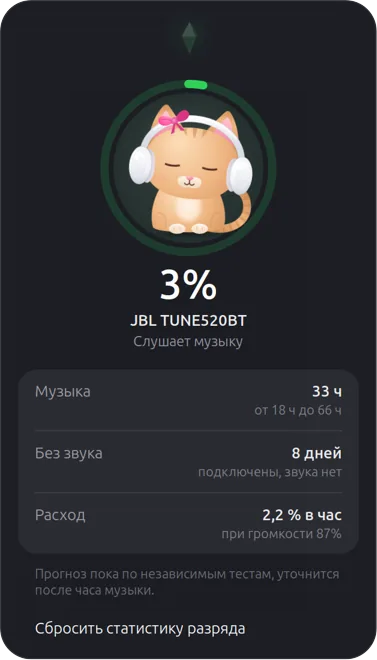
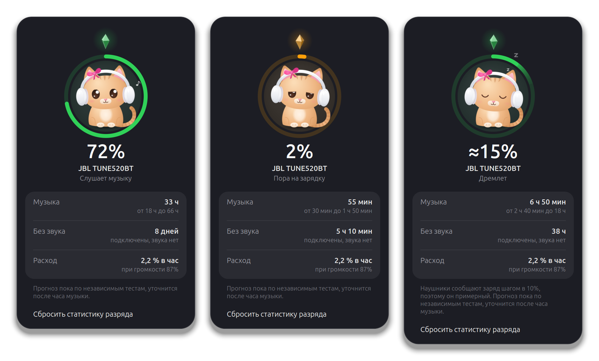
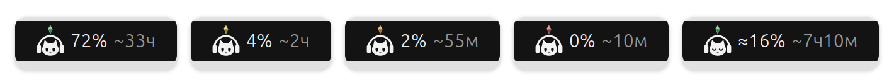

# Headphones Battery

[](https://github.com/lilter96/gnome-headphones-battery/actions/workflows/test.yml)

A GNOME Shell extension that shows the battery of your Bluetooth headphones in
the top bar, and how long the music will actually last. The time comes from a
drain model it learns on your headset. It also has a Sims cat.

<p align="center">
  
</p>





<sub>Rendered at 2× in a throwaway headless GNOME Shell by
[`tools/media/capture.sh`](tools/media/capture.sh), with the numbers computed by the
real estimator. The UI text is Russian.</sub>

## Why

For my JBL Tune 520BT, GNOME showed "20%" and nothing more. That number was a
lie in two ways:

* **It is a 10% bucket.** Over HFP a headset reports its battery as
  `AT+IPHONEACCEV` 0…9, and PipeWire shows it as `(v + 1) × 10`. So "20%"
  really means anywhere from 10% to 19%.
* **A percentage is not a time.** These headphones last about 60 hours. At 20%
  that is 12 hours of music, or far longer if they sit connected and silent.

## How it works

**A precise level.** Many headsets have a second, Bluetooth LE side (here
`JBL TUNE520BT-LE`) with the standard Battery Service (`0x180F`), which reports
1% steps. The extension finds that companion by name and service UUID. It is
not paired, so BlueZ never reconnects it on its own: the extension keeps it
connected while the headset is, with backoff. Without it, the extension uses
the HFP bucket and marks the level as approximate (`≈15%`).

**Remaining time that learns.** The drain rate, in % per hour, is modelled as

```
rate = a·[idle] + b·[playing] + c·[playing]·u,    u = volume³
```

* `u` is PipeWire's cubic volume, roughly the output amplitude. The volume
  comes from the sink, and playback is read from the sink state.
* Every observed 1% drop is one sample:
  `drop = a·t_idle + b·t_play + c·∫u dt` over the time since the previous drop.
* `θ = [a, b, c]` is learned per device by recursive Bayesian least squares.
  * **Prior:** independent run-time tests: SoundGuys 60 h 52 min at 75 dB SPL,
    Gough Lui 60 h 39 min, against JBL's claimed 57 h. Other models start from a
    generic 30 h.
  * **Forgetting factor 0.95:** follows battery ageing and habits. It is capped
    at the prior variance, so directions that are never excited (such as
    volume, if you never change it) don't blow up.
  * **Bounds:** clamped to physical ranges.
* Samples that would lie are skipped:
  * the first, partial drop after connecting;
  * stretches where another device used the headset;
  * HFP steps while the precise LE source is also seen, which would double-count;
  * small rises, which are voltage rebound;
  * big rises, which mean charging.
* Between drops, the charge counts down using the model.
* The popup shows a range as well as the estimate (`from 18 h to 66 h`). It is
  an 80% band from the model's covariance plus the width of the level reading.

**The cat.**
* **Scene:** a Cairo scene drawn as a tree of Clutter actors. Each layer is a
  texture that is redrawn only when its look changes; everything else is a
  transform.
* **Cost:** over 3 s at 165 Hz, the disc, ring and face are painted once, the
  eyes 97 times, and only the small spinning plumbob every frame. A full frame
  costs about 1.6 ms.
* **Motion:** wall-clock springs with SwiftUI's response/damping semantics. A
  new value can interrupt an animation mid-way, and the loops stop when nothing
  moves.
* **Plumbob:** it shows how much music is left. Green means 3 h or more,
  yellow 1–3 h, orange 20 min–1 h, red below that. Colours blend in OKLCH, so
  green turns red through warm hues, not brown.
* **Behaviour:**
  * bobs its head to the beat while music plays;
  * yawns when the battery is low;
  * dozes off after 3 minutes of silence;
  * follows the pointer with its eyes;
  * a click wakes it, or sends a heart.
* **Reduced motion:** with *Reduce Animation* on, everything lands at once.

## Install

GNOME Shell 46 (tested on Ubuntu 24.04).

```sh
git clone https://github.com/lilter96/gnome-headphones-battery
cd gnome-headphones-battery
gnome-extensions pack headphones-battery@terentiy \
    --extra-source=estimator.js --extra-source=pet.js --extra-source=ui.js
gnome-extensions install --force headphones-battery@terentiy.shell-extension.zip
```

Restart the shell (X11: <kbd>Alt</kbd>+<kbd>F2</kbd>, `r`; Wayland: log out and
back in), then run `gnome-extensions enable headphones-battery@terentiy`.

The learned model lives in `~/.local/state/headphones-battery/state.json`.
*Сбросить статистику разряда* (reset discharge statistics) in the popup
returns it to the prior.

## Development

```sh
gjs -m tests/run.js            # 36 tests, no GNOME Shell needed
tools/media/capture.sh         # re-render docs/media (needs a connected headset)
```

* **Unit tests:** `estimator.js` and `pet.js` are pure and run under plain
  `gjs`. The tests cover the estimator's interval logic, learning on a
  simulated discharge, the bounds and the persistence, plus the spring physics,
  OKLCH round trips, the moods, reduced motion, the redraw budget, and
  pixel-level checks of the rendered scene and panel glyph.
* **Media capture:** `capture.sh` runs a headless GNOME Shell with its own
  session bus, dconf and XDG dirs, so your session is never touched. It feeds
  the card demo states and screenshots them. The popup is 98.5% opaque, so the
  composer refuses any frame where something from the desktop shows through.

## Limitations

* The UI is in Russian only.
* Only tested with a JBL Tune 520BT. Other headsets get the level UPower
  reports and a generic prior. The precise level needs an LE companion with
  the Battery Service.
* The time is only as good as the prior until the headset has dropped a few
  percent while you listen. The popup says which one you are looking at.

## License

[MIT](LICENSE)
