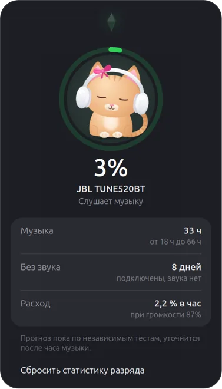
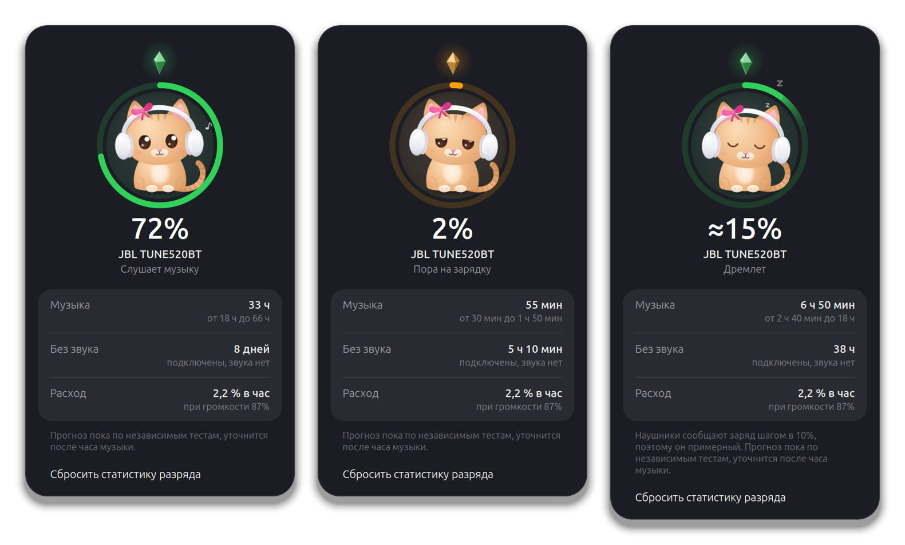
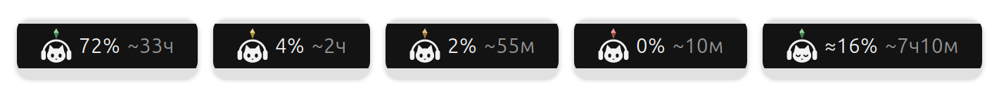

# Headphones Battery

[](https://github.com/lilter96/gnome-headphones-battery/actions/workflows/test.yml)

A GNOME Shell extension that shows the battery of your Bluetooth headphones in
the top bar, and how long the music will actually last. The time comes from a
drain model it learns on your headset. It also has a Sims cat.

<p align="center">
  
</p>





<sub>Rendered at 2× in a throwaway headless GNOME Shell by
[`tools/media/capture.sh`](tools/media/capture.sh), with the numbers computed by the
real estimator. The UI text is Russian.</sub>

## Why

For my JBL Tune 520BT, GNOME showed "20%" and nothing more. That number was a
lie in two ways:

* **It is a 10% bucket.** Over HFP a headset reports its battery as
  `AT+IPHONEACCEV` 0…9, and PipeWire shows it as `(v + 1) × 10`. This headset
  rounds up, so "20%" really means anywhere from 11% to 20%.
* **A percentage is not a time.** These headphones last about 60 hours. At 20%
  that is 12 hours of music, or far longer if they sit connected and silent.

## How it works

**AirPods Pro.** Version 4 reads left, right and case battery percentages over
Apple Accessory Protocol (AAP), through a source-built native L2CAP helper.
Each discharging earbud has its own learned playback estimate; the shorter
estimate drives the panel. Charging earbuds and the case do not drive playback
predictions. Last-known percentages remain visible with their measurement age
when a component stops reporting, and survive reconnection and restarts.
Open the case near the computer to obtain its initial reading. The extension
never invents a percentage for a component that has not reported one.
See [the protocol and persistence details](docs/PROTOCOL.md).


**A precise level.** Many headsets have a second, Bluetooth LE side (here
`JBL TUNE520BT-LE`) with the standard Battery Service (`0x180F`), which reports
1% steps. The extension finds that companion by name and service UUID. It is
not paired, so BlueZ never reconnects it on its own: the extension keeps it
connected while the headset is, with backoff. The headset also never sends
level notifications: BlueZ subscribes, nothing arrives, and the level it read
on connect goes stale for hours. So the extension reads the Battery Level
characteristic (`0x2A19`) itself, once a minute and whenever the popup opens.
Without the companion, the extension uses the HFP bucket and marks the level
as approximate (`≈16%`).

**Remaining time that learns.** The drain rate, in % per hour, is modelled as

```
rate = a·[idle] + b·[playing] + c·[playing]·u,    u = volume³
```

* `u` is PipeWire's cubic volume, roughly the output amplitude. The volume
  comes from the sink, and playback is read from the sink state.
* Every observed 1% drop is one sample:
  `drop = a·t_idle + b·t_play + c·∫u dt` over the time since the previous drop.
* `θ = [a, b, c]` is learned per device by recursive Bayesian least squares.
  * **Prior:** independent run-time tests: SoundGuys 60 h 52 min at 75 dB SPL,
    Gough Lui 60 h 39 min, against JBL's claimed 57 h. Other models start from a
    generic 30 h.
  * **Forgetting factor 0.95:** follows battery ageing and habits. It is capped
    at the prior variance, so directions that are never excited (such as
    volume, if you never change it) don't blow up.
  * **Bounds:** clamped to physical ranges.
* Samples that would lie are skipped:
  * the first, partial drop after connecting;
  * stretches where another device used the headset;
  * HFP steps while the precise LE source is also seen, which would double-count;
  * small rises, which are voltage rebound;
  * big rises, which mean charging.
* Between drops, the charge counts down using the model.
* The popup shows a range as well as the estimate (`from 18 h to 66 h`). It is
  an 80% band from the model's covariance plus the width of the level reading.

**The cat.**
* **Scene:** a Cairo scene drawn as a tree of Clutter actors. Each layer is a
  texture that is redrawn only when its look changes; everything else is a
  transform.
* **Cost:** over 3 s at 165 Hz, the disc, ring and face are painted once, the
  eyes 97 times, and only the small spinning plumbob every frame. A full frame
  costs about 1.6 ms.
* **Motion:** wall-clock springs with SwiftUI's response/damping semantics. A
  new value can interrupt an animation mid-way, and the loops stop when nothing
  moves.
* **Plumbob:** it shows how much music is left. Green means 3 h or more,
  yellow 1–3 h, orange 20 min–1 h, red below that. Colours blend in OKLCH, so
  green turns red through warm hues, not brown.
* **Behaviour:**
  * bobs its head to the beat while music plays;
  * yawns when the battery is low;
  * dozes off after 3 minutes of silence;
  * follows the pointer with its eyes;
  * a click wakes it, or sends a heart.
* **Reduced motion:** with *Reduce Animation* on, everything lands at once.

## Install

GNOME Shell 46 (tested on Ubuntu 24.04).

Build dependencies: GCC and BlueZ headers (`libbluetooth-dev` on Ubuntu).

```sh
git clone https://github.com/lilter96/gnome-headphones-battery
cd gnome-headphones-battery
make install
```

The installer compiles the helper, copies only runtime files and retains the
previous installation outside the extensions directory. It does not modify
learned statistics or grant capabilities. No sudo is needed for installation.
Restart GNOME Shell after installation (X11: <kbd>Alt</kbd>+<kbd>F2</kbd>, `r`;
Wayland: log out and back in), then enable it:

```sh
gnome-extensions enable headphones-battery@terentiy
make doctor
```

The learned models and last-known component readings live in
`~/.local/state/headphones-battery/state.json`. The reset action in the popup
resets discharge calibration. AAP needs the paired AirPods to be connected.

## Development

Development dependencies: Node.js 24, GJS, GCC, BlueZ headers, ShellCheck,
D-Bus and GdkPixbuf introspection data.

```sh
make check                    # JS/GJS, native, sanitizers, static checks, installer
make test                     # tests without sanitizers/static analysis
tools/media/capture.sh        # documentation renderer (needs a connected headset)
```

The AirPods suites include source arbitration, per-component history and
forecasts, actual extension orchestration with Shell mocks, real GJS
subprocesses, private D-Bus, atomic persistence and isolated install/rollback.
Native tests use socketpairs and synthetic protocol frames. They do not contact
Bluetooth hardware. The original estimator, pet animation and pixel-level
rendering tests remain part of `make check`.

## Limitations

* The UI is in Russian only; GNOME Shell 46 is supported.
* Live reception and cached display were verified with the connected AirPods Pro
  on 2026-11-23. Other AirPods generations and firmware remain unverified.
* A closed or out-of-range case may stop transmitting its own charge and the
  charge of a stored earbud. The last received values are shown with their age,
  not presented as live measurements.
* Playback time starts from an approximate family prior and improves with
  observed discharge; it depends on listening mode, volume and battery health.
* JBL Tune 520BT retains its standard LE companion and HFP fallback paths.
  Other headsets use available standard battery sources and a generic prior.

A sibling of [gnome-dota-time](https://github.com/lilter96/gnome-dota-time):
the same spring animation and the same approach to a character, with Roshan
keeping count of your Dota evenings.

## License

[MIT](LICENSE)
